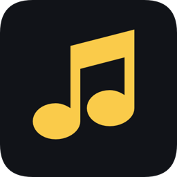

# YaGo

Лёгкий неофициальный клиент Яндекс Музыки на Go.

**[Скачать Windows EXE](https://github.com/OLDest/yago-releases/releases/latest/download/YaGo.exe)** · **[Скачать Android APK](https://github.com/OLDest/yago-releases/releases/latest/download/YaGo-android.apk)** · [Все версии](https://github.com/OLDest/yago-releases/releases)

Windows x64. Android 8.0+, ARM64/ARMv7, OpenGL ES 3.0.

Иконки приложения, «Моя волна», поиск, библиотека, очередь и шафл без повторов. Вход через код Яндекса; полные треки требуют подписки сервиса. Проект не связан с Яндексом.

## Обновления

Начиная с 0.3.0 приложение проверяет этот публичный репозиторий автоматически. Вход GitHub не нужен. Подпись Ed25519 и SHA-256 проверяются до установки. Android требует системного подтверждения установки. Windows перезапускается после подтверждения пользователя.

Установите новую версию поверх старой. Для Android сохранены идентификатор пакета и сертификат. Установку обновления на физическом Android ещё нужно проверить.

## Исходники и лицензия

GPL-3.0-only. В каждом релизе есть **YaGo-X.Y.Z-source.zip** с соответствующими исходниками и сборочными скриптами, LICENSE и THIRD_PARTY_NOTICES.txt. История рабочего Git сюда не копируется. Автоматический GitHub Source code архив содержит только файлы этой страницы; полный код приложения — в отдельном YaGo-X.Y.Z-source.zip.

Для Windows с установленным Go 1.25+ распакуйте исходники, выполните go run scripts/icon.go, go install github.com/akavel/rsrc@v0.10.2, rsrc -ico assets/icon.ico -arch amd64 -o icon_windows_amd64.syso, затем go build -trimpath -ldflags="-s -w -H=windowsgui" -o YaGo.exe . . Подробнее в README внутри архива. Android требует SDK/NDK и собственного ключа подписи.

[Сообщить об ошибке](https://github.com/OLDest/yago-releases/issues)
